### Enes

<picture>
  <source media="(prefers-color-scheme: dark)" srcset="snake-dark.svg" />
  <source media="(prefers-color-scheme: light)" srcset="snake-light.svg" />
  
</picture>

Yılan dekoratiftir, gerçek katkı grafiğim değil — <code>make_snake.py</code> ile üretildi.
